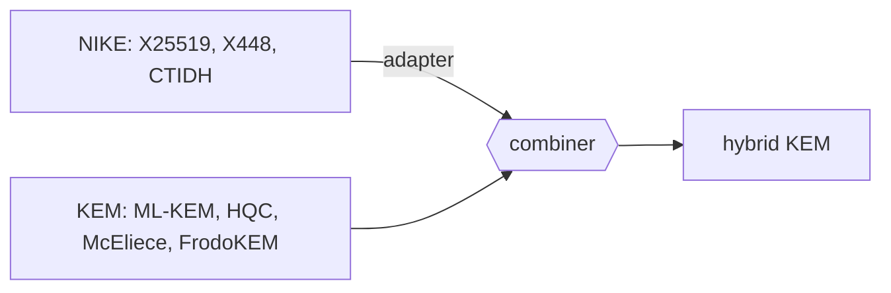

# hpqc

[](https://pkg.go.dev/github.com/katzenpost/hpqc)
[](https://pypi.org/project/hpqc/)
[](https://github.com/katzenpost/hpqc/actions/workflows/go.yml)
[](https://github.com/katzenpost/hpqc/actions/workflows/python.yml)

hpqc is a hybrid post-quantum cryptography library. It offers KEMs, NIKEs and
signature schemes behind common `Scheme` interfaces, builds hybrids from them,
and implements the BACAP capability scheme. [Katzenpost](https://katzenpost.network)
uses it. Go is the reference implementation; the Python and Rust ports
cover parts of it, and all three check the same [test vectors](testvectors/).
hpqc has had no external security review and should be considered experimental.



## Quick start

Go, with cgo and a C compiler (error checks left out):

```go
import "github.com/katzenpost/hpqc/kem/schemes"

kem := schemes.ByName("MLKEM768-X25519")
pk, sk, err := kem.GenerateKeyPair()
ct, secret, err := kem.Encapsulate(pk)
secret2, err := kem.Decapsulate(sk, ct) // equal to secret
```

Python, after `pip install hpqc`:

```python
from hpqc.nike.x25519 import X25519
from hpqc.protocols.sealedbox import SealedBoxScheme

nike = X25519()
pk, sk = nike.generate_keypair()
box = SealedBoxScheme(nike)
assert box.open(sk, pk, box.seal(pk, b"hello")) == b"hello"
```

Rust, which is not yet on crates.io: `cargo add hpqc --git https://github.com/katzenpost/hpqc`,
then see [rust/README.md](rust/README.md).

## Docs

- [Schemes](docs/schemes.md): every scheme name in Go, Python and Rust
- [Using hpqc from Go](docs/go.md) and the [Python port](py/README.md)
- [Constructions](docs/constructions.md): the NIKE adapter, KEM combiner, MKEM and sealed box
- [BACAP](docs/bacap.md) and [CTIDH](docs/ctidh.md)
- [Building and testing](docs/building.md), [repository layout](docs/layout.md), [breaking changes](BREAKING_CHANGES.md) and [planned changes](PLANNED_CHANGES.md)

## Related

- [circl](https://github.com/katzenpost/circl): fork of Cloudflare's CIRCL, source of ML-KEM-512 and -1024, FrodoKEM, Classic McEliece, Kyber768, X448, Ed448 and EdDilithium
- [sntrup4591761](https://github.com/katzenpost/sntrup4591761), [sphincsplus](https://github.com/katzenpost/sphincsplus) and [falcon](https://github.com/katzenpost/falcon): the NTRU Prime, SPHINCS+ and Falcon implementations
- [chacha20](https://github.com/katzenpost/chacha20) and [chacha20poly1305](https://github.com/katzenpost/chacha20poly1305): forks of Yawning Angel's ciphers, used by `rand` and MKEM
- [highctidh-rs](https://github.com/katzenpost/highctidh-rs): Rust bindings to highctidh's CTIDH-1024
- [nyquist](https://github.com/katzenpost/nyquist): a fork of Yawning Angel's Noise library that uses hpqc's KEMs
- [Cryptlib](https://github.com/katzenpost/cryptlib): a Lean cryptography library whose hedged ML-KEM and BACAP agree with hpqc's under shared vectors

## License

AGPL-3.0-only; see [LICENSE](LICENSE). `kem/interfaces.go` and `sign/interfaces.go`
come from circl, whose KEM and signature interfaces hpqc follows. `nike/diffiehellman`
comes from Elixxir and keeps its [BSD 2-clause license](nike/diffiehellman/LICENSE).
