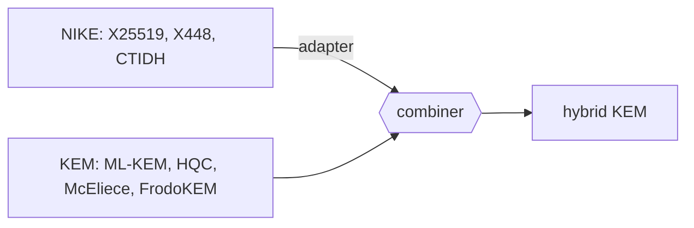

# hpqc

[](https://pkg.go.dev/github.com/katzenpost/hpqc)
[](https://pypi.org/project/hpqc/)
[](https://github.com/katzenpost/hpqc/actions/workflows/go.yml)
[](https://github.com/katzenpost/hpqc/actions/workflows/python.yml)

hpqc is a hybrid post-quantum cryptography library. It offers KEMs, NIKEs and
signature schemes behind common `Scheme` interfaces, builds hybrids from them,
and implements the BACAP capability scheme. [Katzenpost](https://katzenpost.network)
uses it. Go is the reference implementation; the Python and Rust ports
cover parts of it, and all three check the same [test vectors](testvectors/).
hpqc has had no external security review and should be considered experimental.
It is written for developers building post-quantum protocols. It provides no
protocol, transport or general-purpose cipher API of its own; if you need
reviewed ML-KEM alone, Go's `crypto/mlkem` or [CIRCL](https://github.com/cloudflare/circl)
is the better choice.



## Quick start

Go 1.26.2 or later, with cgo and a C compiler: `go get github.com/katzenpost/hpqc`,
then (error checks left out):

```go
import "github.com/katzenpost/hpqc/kem/schemes"

kem := schemes.ByName("MLKEM768-X25519")
pk, sk, err := kem.GenerateKeyPair()
ct, secret, err := kem.Encapsulate(pk)
secret2, err := kem.Decapsulate(sk, ct) // equal to secret
```

Python, after `pip install hpqc`:

```python
from hpqc.nike.x25519 import X25519
from hpqc.protocols.sealedbox import SealedBoxScheme

nike = X25519()
pk, sk = nike.generate_keypair()
box = SealedBoxScheme(nike)
assert box.open(sk, pk, box.seal(pk, b"hello")) == b"hello"
```

Rust, which is not yet on crates.io: `cargo add hpqc --git https://github.com/katzenpost/hpqc`,
then see [rust/README.md](rust/README.md).

## Docs

- [Schemes](docs/schemes.md): every scheme name in Go, Python and Rust
- [Using hpqc from Go](docs/go.md) and the [Python port](py/README.md)
- [Constructions](docs/constructions.md): the NIKE adapter, KEM combiner, MKEM and sealed box
- [BACAP](docs/bacap.md) and [CTIDH](docs/ctidh.md)
- [Related repositories](docs/related.md): the forks hpqc depends on and the projects that use or cross-check it
- [Building and testing](docs/building.md), [repository layout](docs/layout.md), [breaking changes](BREAKING_CHANGES.md) and [planned changes](PLANNED_CHANGES.md)

## Status

Version 0.0.95 is the latest Go module tag and the current PyPI release
(Python 3.10 or later); the Rust crate is 0.1.0 and unpublished. Before 1.0
the API still changes: [BREAKING_CHANGES.md](BREAKING_CHANGES.md) lists each
break. Interoperability between the ports rests on the shared vectors in
[testvectors/](testvectors/).

## Testing and contributing

[docs/building.md](docs/building.md) gives the test commands for each
language. Report bugs and send pull requests on GitHub.

## License

AGPL-3.0-only; see [LICENSE](LICENSE). `kem/interfaces.go` and `sign/interfaces.go`
come from circl, whose KEM and signature interfaces hpqc follows. `nike/diffiehellman`
comes from Elixxir and keeps its [BSD 2-clause license](nike/diffiehellman/LICENSE).
